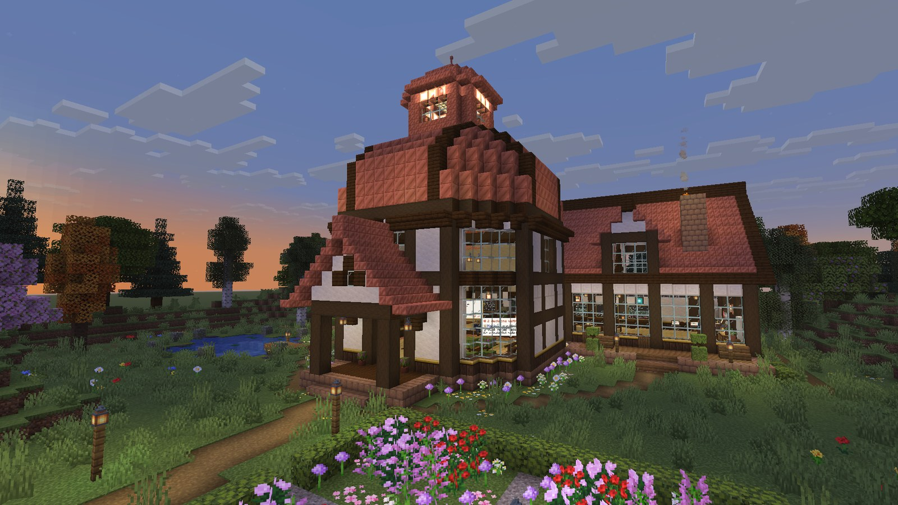
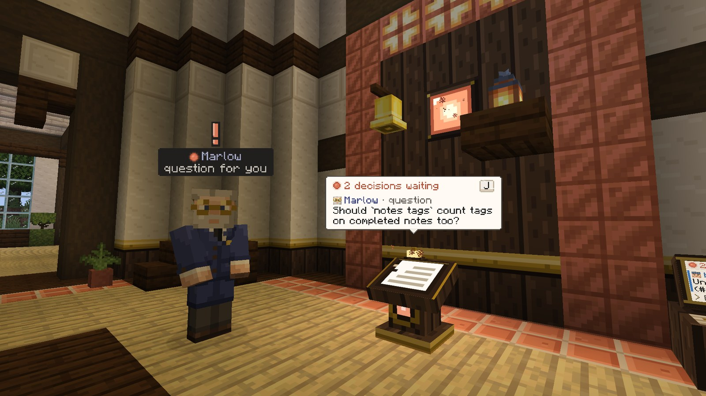

# Coliseum

**Your AI development team, working inside a Minecraft office you can walk around in.**

A fork of [AgentCraft](https://github.com/blendi-remade/agentcraft) by [Blendi](https://github.com/blendi-remade), enhanced with six office themes, a Coliseum debate arena, a CLI bridge, and a smart autopilot.

## Table of Contents

- [Features](#features)
- [Quickstart: Office mode](#quickstart-office-mode)
- [Quickstart: Coliseum mode](#quickstart-coliseum-mode)
- [Screenshots](#screenshots)
- [The Bridge (CLI Integration)](#the-bridge-cli-integration)
- [Office Themes](#office-themes)
- [Requirements](#requirements)
- [Project Structure](#project-structure)
- [Configuration](#configuration)
- [Contributing](#contributing)
- [License](#license)
- [Credits](#credits)

## Features

### 6 Office Themes

Pick the look of your HQ: `warm_studio`, `modern_glass`, `executive`, `industrial`, `minimal`, or `penthouse`. Set one with `node tools/setup.mjs --theme <id>`. See [Office Themes](#office-themes) for the style of each.

### Coliseum Arena

A Roman Colosseum-inspired elliptical amphitheater with 8 debate podiums and tiered seating for spectators. Switch to it in-game with `/agentcraft hq coliseum` (and back with `/agentcraft hq openclaw`).

Two palette variants share the same arena layout:

- **Nether** (`coliseum_nether`) -- a hellish Nether palette built from nether bricks, blackstone, and magma. Use `/agentcraft hq coliseum_nether`.
- **Ice** (`coliseum_ice`) -- a frozen ice palette. Use `/agentcraft hq coliseum_ice`.

### Arena Bridge

`tools/arena-bridge.mjs` runs a battle royale where 16-100 AI agents debate a topic at once. Use `start` to begin, `spectate` for the live commentary feed, and `scoreboard` for current rankings.

### Smart Autopilot

Let the team run unattended: `node tools/bridge.mjs autopilot` auto-approves permission requests and validates merges against criteria (CI passing, change size, and sensitive files such as env/config/auth). `run "<goal>" --autopilot` submits a goal, watches it, and auto-approves in one command.

### Spectator Mode

In Minecraft, fly above the arena in spectator mode and watch agents argue in real time with speech bubbles. From a terminal, `node tools/arena-bridge.mjs spectate` streams the same action as a live feed.

### Multi-repo

Register several repositories (`repo-add <path>`, list with `repos`) and target a goal at one of them with `goal "..." --repo <name>`.

### Setup, Headless, and Bypass Permissions

- **Setup wizard** -- `node tools/setup.mjs` configures auth (Claude Login or API key), theme, and repos interactively.
- **HQ mode** -- `node tools/setup.mjs --hq-mode <id>` sets the default HQ used at launch. Valid ids: `openclaw` (Office, default), `coliseum`, `coliseum_nether`, `coliseum_ice`.
- **Headless mode** -- `node tools/launch.mjs` runs the team without a Minecraft window; add `--game` for the visual client.
- **Bypass permissions** -- agents work autonomously without stopping to ask.

## Quickstart: Office mode

1. Configure auth, theme, and repos (interactive):

   ```bash
   node tools/setup.mjs
   ```

2. Launch the team -- headless by default, or with the Minecraft window:

   ```bash
   node tools/launch.mjs          # headless
   node tools/launch.mjs --game   # with Minecraft
   ```

3. Submit a goal through the bridge:

   ```bash
   node tools/bridge.mjs status
   node tools/bridge.mjs goal "Add dark mode to the settings page"
   ```

4. Watch progress and approve work:

   ```bash
   node tools/bridge.mjs watch
   node tools/bridge.mjs decisions
   node tools/bridge.mjs merge <id>
   ```

   Or skip manual approval: `node tools/bridge.mjs autopilot`, or `node tools/bridge.mjs run "Add dark mode" --autopilot`.

## Quickstart: Coliseum mode

1. Run setup: `node tools/setup.mjs`
2. Launch with the game window: `node tools/launch.mjs --game`
3. In Minecraft, switch to the arena: `/agentcraft hq coliseum` (or `coliseum_nether` / `coliseum_ice` for the Nether and Ice variants).

   Alternatively, set the default HQ used at launch before starting the game, instead of switching in-game:

   ```bash
   node tools/setup.mjs --hq-mode coliseum   # or coliseum_nether, coliseum_ice, openclaw
   ```

4. Start a battle royale:

   ```bash
   node tools/arena-bridge.mjs start "Best frontend framework for our stack" --agents 16
   ```

5. Spectate the live feed (or fly above the arena in-game): `node tools/arena-bridge.mjs spectate`
6. Check the standings: `node tools/arena-bridge.mjs scoreboard`

## Screenshots

<!-- Placeholders: the images below marked "(placeholder)" still need to be captured and added under docs/img/readme/. -->


*The HQ, with agents at work.*


*A debate podium.*


*Warm Studio office theme (placeholder).*


*Penthouse office theme (placeholder).*


*The Coliseum arena with 8 podiums and tiered seating (placeholder).*


*Flying above the arena in spectator mode (placeholder).*


*Driving the team from the terminal with bridge.mjs (placeholder).*


*Autopilot approving permissions and merges (placeholder).*

## The Bridge (CLI Integration)

The OpenClaw Bridge lets you orchestrate the team from any terminal:

```bash
node tools/bridge.mjs status                    # team overview + cost
node tools/bridge.mjs agents                    # who's doing what
node tools/bridge.mjs goal "..." [--repo name]  # submit work (optionally to a specific repo)
node tools/bridge.mjs tasks [goalId]            # task board
node tools/bridge.mjs decisions                 # pending decisions
node tools/bridge.mjs merge <id>                # approve a merge
node tools/bridge.mjs diff <worktree>           # review changes
node tools/bridge.mjs msg <agent|all> "..."     # message an agent
node tools/bridge.mjs repos                     # list registered repos
node tools/bridge.mjs decide <id> <option> [text]  # answer a decision
node tools/bridge.mjs repo-add <path>           # register a repo
node tools/bridge.mjs cost                      # total API cost
node tools/bridge.mjs watch                     # live event stream
node tools/bridge.mjs autopilot                 # auto-approve with smart merge criteria
node tools/bridge.mjs run "goal" --autopilot    # submit + watch + auto-approve in one
```

## Office Themes

| Theme | Style |
|-------|-------|
| `warm_studio` | Original -- timber frame, copper dome, plaster walls, parquet floors |
| `modern_glass` | Contemporary -- quartz, glass, iron, polished stone |
| `executive` | Premium -- deepslate, dark oak, tinted glass, soul lanterns |
| `industrial` | Loft -- exposed brick, iron, spruce, concrete |
| `minimal` | Clean -- white quartz, birch, light gray, very minimal |
| `penthouse` | Luxury -- blackstone, gilded accents, crimson wood, red sofas |

Set with `node tools/setup.mjs --theme executive` (or run the wizard).

### Arena Maps

| Map | Style |
|-----|-------|
| `coliseum` | Roman Colosseum -- elliptical amphitheater, sandstone, 8 debate podiums |
| `coliseum_nether` | Nether Coliseum -- the same arena in a hellish Nether palette (nether bricks, blackstone, magma) |
| `coliseum_ice` | Ice Coliseum -- the same arena in a frozen ice palette |

Switch in-game: `/agentcraft hq <id>` (`coliseum`, `coliseum_nether`, `coliseum_ice`, or `openclaw` to go back to the office)

## npm Scripts

Run `cd tools && npm install` once first (the bridge scripts need `ws`). Then from the repo root:

```bash
npm run setup     # interactive setup wizard (tools/setup.mjs)
npm run launch    # start the team (tools/launch.mjs); pass flags after --, e.g. npm run launch -- --game
npm run bridge    # CLI bridge (tools/bridge.mjs); e.g. npm run bridge -- status
npm run arena     # arena bridge (tools/arena-bridge.mjs)
```

## Requirements

- **Java 25** ([Eclipse Temurin](https://adoptium.net/))
- **Node.js 22+**
- **Minecraft: Java Edition** (for visual mode; not needed for headless)
- **Claude API key** or **Claude Max subscription**

## Project Structure

```
foreman/        TypeScript backend — manages agents, tasks, decisions, repos
mod/            Fabric mod (Java) — the Minecraft client with HQ, agents, UI
tools/          CLI tools — launcher, bridge, setup wizard, dev utilities
assets-src/     Asset pipeline — block models, textures, skins, UI style tokens
docs/           Protocol spec, console design, QA guides
sandbox/        Demo scaffolding for the sim backend
```

## Configuration

Run `node tools/setup.mjs` to configure interactively, or use flags:

```bash
node tools/setup.mjs --auth api-key --key YOUR_API_KEY_HERE
node tools/setup.mjs --auth claude-login
node tools/setup.mjs --theme modern_glass
```

Config is stored in `~/.coliseum/config.json` (never committed).

## Contributing

1. Fork the repo and create a feature branch.
2. Make your change and run the tests:

   ```bash
   cd foreman && npm run check   # typecheck + vitest + protocol doc
   cd tools && npm test          # node --test
   ```

3. Open a pull request.

See [CONTRIBUTING.md](./CONTRIBUTING.md) for the full guide.

## License

MIT License. See [LICENSE](./LICENSE) for the full text.

## Credits

Created by **Guillermo Von Papendieck** ([guillermomeana-coder](https://github.com/guillermomeana-coder)) — OpenClaw / [Elevyte](https://orionblue.space).

Built on [AgentCraft](https://github.com/blendi-remade/agentcraft) by [Blendi](https://github.com/blendi-remade). Development assisted by Claude (Anthropic).
